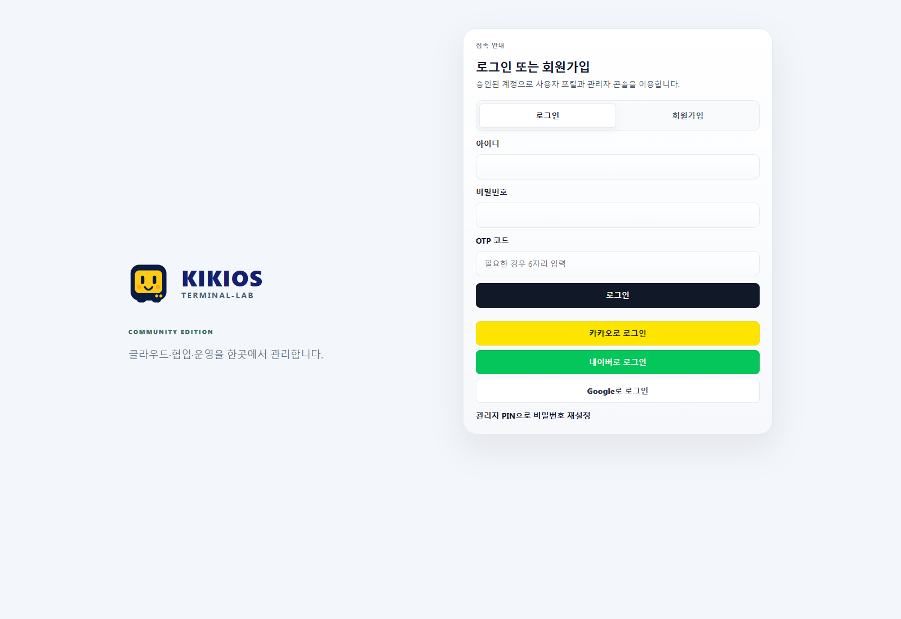
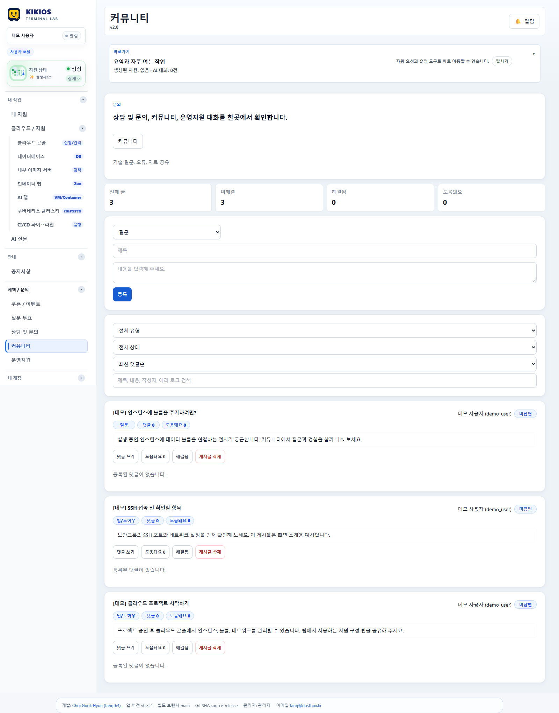
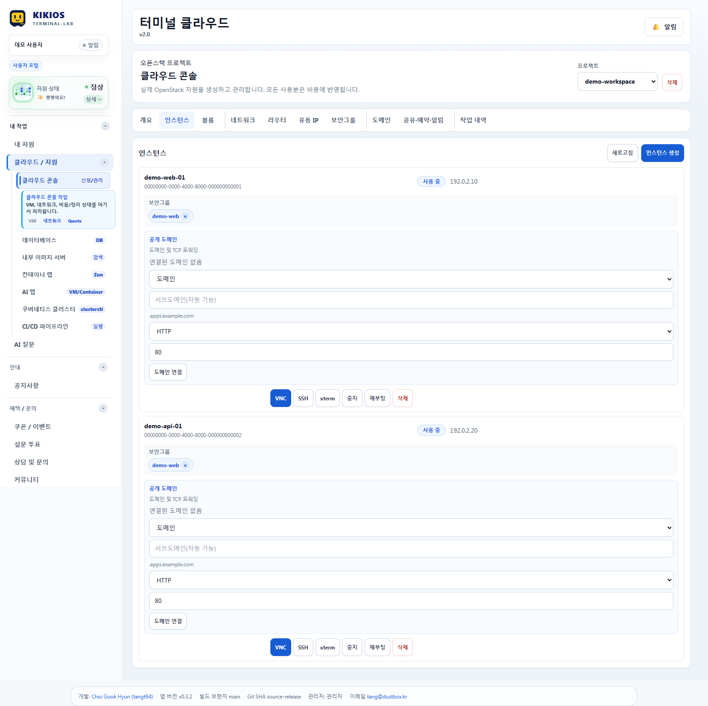
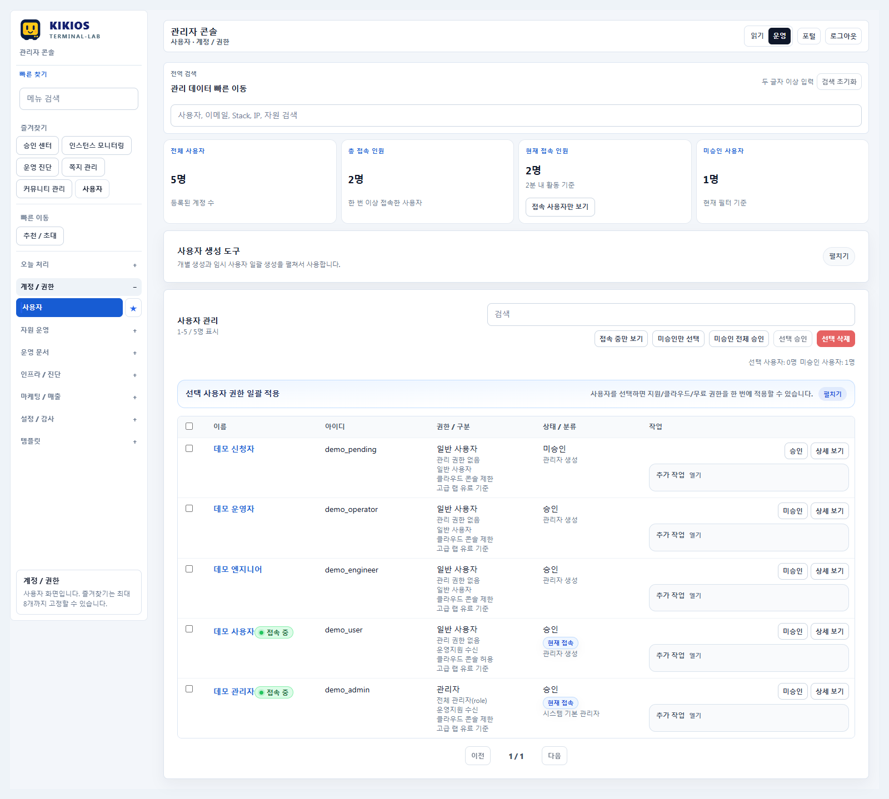

# KIKI OS TERMINAL-LAB Community 0.3.2


제품 브랜드는 **KIKI OS TERMINAL-LAB · Community Edition**입니다. KIKI-OS의 노란색 박스 마스코트를 사용합니다. 위 이미지는 원본 KIKI · 키키 로고이며, UI용 아이콘은 기존 벡터 원본에서 마스코트 도형을 그대로 분리했습니다. 로그인·사용자 포털·관리자 콘솔에서 `KIKIOS`와 `TERMINAL-LAB`을 함께 표시하며, 파비콘과 관리자 미리보기에도 같은 마스코트 아이콘을 사용합니다. 로고 출처와 별도 라이선스는 [브랜드 고지](platform/client/public/brand/ORIGIN.md)를 참조하세요.

0.3.0부터 저장소·패키지·배포 파일은 `kiki-terminal-lab` 이름을 사용합니다. 기존 Terminal Lab Community 0.2.x 설치의 상태 경로와 볼륨·키는 유지하며, [이름 전환 절차](docs/installation.md#02x-community에서-kiki-030으로-이름-전환)로 업데이트합니다.

Maintained by **Choi Gook Hyun ([tangt64](https://github.com/tangt64))** · 문의: [tang@dustbox.kr](mailto:tang@dustbox.kr) · MIT

Self-hosted OpenStack portal for general users and administrators, with SSO, OTP, community posts and infrastructure management. Education features and Lab Board are excluded.

이 버전은 **배포 준비본(Preview)**입니다. 소스·API·브라우저 테스트를 수행했으며, 실제 Linux 컨테이너 설치·복원과 운영 인프라 연결은 별도 검증이 필요합니다.

기존 Terminal Lab에서 교육 기능을 제외하고 일반 사용자·관리자 기능을 분리한 독립 설치형 배포본입니다. 일반 사용자·관리자 기능은 원본 UI·API를 기반으로 유지합니다. 이 디렉터리 전체를 별도 Git 저장소의 루트로 사용할 수 있습니다. 기존 Terminal Lab의 소스·DB·설정·배포 스크립트는 참조하지 않습니다.

## 사용 환경과 개발 상태

- **Linux 배포판:** Podman 또는 Docker로 Linux 컨테이너를 정상 실행할 수 있으면 사용 가능합니다. Python과 선택한 엔진의 네트워크·볼륨·사용자 권한 조건도 충족해야 합니다. 특정 배포판으로 제한하지 않으며, 모든 배포판의 설치 검증을 완료한 상태는 아닙니다.
- **CPU:** 현재 x86 계열의 **64비트 x86_64/amd64만 지원 대상**입니다. 32비트 x86과 ARM64는 현재 지원하지 않습니다.
- **기반 인프라:** 현재 OpenStack 기반으로 사용할 수 있으며, 기존 OpenStack의 인증·컴퓨트·이미지·네트워크 API에 연결합니다. 사용 기능별로 필요한 서비스가 있어야 합니다.
- **개발 중:** 현재 **OpenStack과 호환되는 경량 플랫폼을 구성 중**입니다. 해당 플랫폼 연동은 준비 단계이며, 기본적인 기능검증 및 구현이 되면 릴리즈할 예정입니다.

0.2.2에서 제한 관리자 권한 상승을 차단하고, 교육 진입점·커리큘럼 데이터·기존 내부망 기본값을 정리했습니다. 검증 내용과 공개 전 남은 작업은 [공개·운영 전 정리 항목](docs/development.md#공개운영-전-정리-항목)을 참조하세요. 실제 Linux 설치·복원과 운영 인프라 연결은 별도 검증 대상이며, 저장소는 비공개로 유지합니다.

## 포함 기능

| 영역 | 기능 |
| --- | --- |
| 계정·인증 | 가입·승인, 비밀번호 재설정, Google/Kakao/Naver SSO, OTP 등록·로그인, 약관·동의 |
| 협업 | 공지, 커뮤니티 게시판·Q&A, 쪽지, 상담 |
| 사용자 자원 | 전용 프로젝트, 클라우드 콘솔, VM·ISO·볼륨·네트워크·라우터·보안그룹·Floating IP·콘솔 접속 |
| 선택 인프라 | AI 자원, Zun 컨테이너, Kubernetes/CAPO, Trove, 로드밸런서·공유 스토리지·예약 등 기존 서비스 연동 |
| 운영 | 사용자·관리자 권한, 승인, 플랫폼 설정, SSO·OTP 설정, 메일·메시지 관리, 마케팅 설문·이벤트 |
| 관리자 도구 | 모니터링·진단, 보안점검, 감사·접속 로그, 자원 정리, CI/CD·Jenkins, LLM, 템플릿 관리 |
| 배포 | 독립 앱 이미지, 전용 PostgreSQL·파일 볼륨, Podman/Docker 인스톨러, 백업·업데이트 |

기존 터미널 랩에서 제공하였던 **교육 과정·커리큘럼·교재·강의 일정·수강 권한·교육 랩실·시험·수료증·교육 설문·과정 견적/결제·강사 공유·교육 역량 진단**은 제외했습니다.
**교육 보고서·교육 랩 터미널·강사 공유 WebSocket·검증용 과정 생성 경로도 제거**했습니다. 

공통 쿼리 호환성을 위해 DB의 교육 호환 테이블과 일부 비활성 호환 코드·빈 화면 스텁은 남아 있습니다. 이 배포본의 초기화는 교육 콘텐츠를 생성하지 않습니다. 원본 수강생 정보·운영 DB·운영 자격증명 파일과 원문 커리큘럼 데이터는 현재 배포 소스에서 제외합니다. 과거 교육 콘텐츠가 포함된 이력·릴리스는 별도 비공개 아카이브에 보존했습니다. 현재 저장소에는 정리된 Community 이력만 포함하며 계속 비공개로 유지합니다.

## 화면 미리보기

KIKI OS TERMINAL-LAB Community 0.3.2의 실제 UI를 노란색 KIKI 마스코트와 데모 데이터로 캡처했습니다(2026-11-03). 계정·게시물·프로젝트·IP는 가상 예시이며 운영 데이터와 인증 정보는 포함하지 않습니다. 클라우드 자원은 브라우저의 데모 API 응답으로 표시했습니다. 이 화면은 실제 OpenStack 연결이나 SSO 공급자 인증을 검증한 결과가 아닙니다.

### 로그인·SSO·OTP

아이디·비밀번호 로그인, OTP 입력과 Google/Kakao/Naver 로그인 진입점입니다.



### 일반 사용자 포털·커뮤니티

사용자 메뉴와 질문·팁 공유, 게시물 검색 및 상태 관리를 보여 줍니다.



### 클라우드 콘솔

가상 프로젝트의 인스턴스 목록, 보안그룹 및 콘솔 접속·자원 관리 도구입니다. IP는 문서 예시용 대역을 사용했습니다.



### 관리자·사용자 관리

가상 계정 5개로 가입 승인, 사용자 권한 및 접속 현황을 보여 줍니다.



## 설치

전체 절차와 조건은 [설치 방법·환경 조건·서버 사양](docs/installation.md)에 정리되어 있습니다. 다음 사양은 앱과 전용 DB를 함께 실행할 때의 **초기 계획 기준이며 부하 시험으로 보장한 최소 사양은 아닙니다.** OpenStack VM 실행 자원은 별도입니다.

| 항목 | 기준 |
| --- | --- |
| 운영 배포 대상 | Podman 또는 Docker로 Linux 컨테이너 실행이 가능한 Linux 배포판. 배포판별 실제 설치 검증은 필요 |
| CPU 아키텍처 | 현재 64비트 x86_64/amd64 전용. 32비트 x86·ARM64 미지원 |
| 가벼운 평가 사양 | 2 vCPU · RAM 4 GiB · SSD 여유 40 GiB 이상 |
| 소규모 운영 시작 사양 | 4 vCPU · RAM 8 GiB · SSD 여유 80 GiB 이상 |
| 호스트 도구 | Python 3.9 이상이라는 코드 요구조건, OS가 보안 지원하는 버전과 Podman/Docker 사용 |
| 컨테이너 구성 | Node.js 22 앱 + PostgreSQL 17 + 전용 DB/파일 볼륨 |
| 필수 준비 | 기존 OpenStack, 서비스 계정 clouds.yaml, 사용 가능한 앱 포트 |
| 외부 접속 | DNS·HTTPS 프록시·인증서·WebSocket 전달; 로컬 평가 기본 포트 4080 |

대상: x86_64/amd64 Linux 또는 해당 아키텍처의 WSL2 Linux 환경, Python 3.9 이상, Podman 또는 Docker. 기존 OpenStack 기반으로 사용하며 인스톨러는 OS/OpenStack 자체를 설치하지 않습니다. 처음 빌드할 때 npm·컨테이너 레지스트리 네트워크가 필요합니다.

`deploy/clouds.example.yaml`을 외부 보안 경로에 복사해 실제 서비스 계정으로 설정합니다. 사용자별 프로젝트를 구성하려면 해당 계정에 프로젝트 생성·역할·쿼터 설정 권한이 필요합니다.

```bash
python3 installer/install.py plan --engine podman
python3 installer/install.py install \
  --engine podman \
  --clouds /secure/community-clouds.yaml \
  --cloud-name community \
  --service-project admin \
  --public-url http://localhost:4080
```

Docker는 `--engine docker`, 사설 CA는 `--ca /secure/openstack-ca.crt`를 지정합니다. 기본 바인딩은 `127.0.0.1:4080`입니다. 외부 제공 시 `--public-url https://portal.example.com --trust-proxy`와 신뢰하는 한 단계 TLS 역방향 프록시를 구성합니다. 앱에 직접 접속하는 환경에서는 프록시 신뢰를 켜지 않습니다. 직접 포트를 공개하려면 `--bind 0.0.0.0`을 지정합니다.

앱·DB·네트워크·볼륨 이름에 무작위 설치 ID를 붙입니다. DB 포트는 호스트에 공개하지 않습니다. 최초 계정은 `runtime/deployment/initial-admin.txt`에 생성되며 로그인 후 비밀번호를 바꿉니다. 플랫폼 설정에서 설치 환경의 실제 프로젝트·이미지·Flavor·네트워크·도메인을 직접 지정합니다.

## SSO·OTP·외부 연동

관리자 → **SSO 로그인**에서 공급자별 사용 여부·Client ID·Secret·콜백 주소를 설정합니다. 공급자에 등록할 콜백은 `https://portal.example.com/api/auth/oauth/{google|kakao|naver}/callback`입니다. 설치 환경의 OAuth 앱을 등록해야 합니다.

OTP는 관리자 설정에서 활성화하고 사용자가 기존 등록 절차로 설정합니다. 메일(SMTP), Jenkins, 레지스트리, Kubernetes/CAPO, LLM 등도 관리자 화면이나 환경변수로 실제 서비스 정보를 입력합니다. 해당 인프라가 없는 기능은 기존 방식대로 비활성 또는 구성 필요 상태입니다. SSO 공급자 응답은 테스트 대역으로 검증했으며 실제 공급자·OpenStack에 대한 운영 연결 시험은 별도로 필요합니다.

공개 도메인·SSH·자원 라우팅은 기존 플랫폼의 설정·내보내기 방식을 유지합니다. 프록시가 필요하면 **이 설치의 데이터 경로에 생성된 설정만** 연결합니다. 기본 설치가 기존 HAProxy/nginx 설정을 수정하지는 않습니다. SSH known_hosts는 이 설치의 데이터 볼륨에 저장합니다.

## 운영

```bash
python3 installer/install.py status
python3 installer/install.py backup
python3 installer/install.py stop
python3 installer/install.py start
python3 installer/install.py update
python3 installer/install.py uninstall
```

상태 경로를 바꿨다면 모든 명령에 같은 `--state-dir /path/to/deployment`를 지정합니다. `backup`은 앱을 잠시 중지하고 DB 덤프와 업로드·템플릿 등 파일 백업을 함께 생성합니다. `uninstall`은 앱·DB 컨테이너만 제거하고 볼륨·키·설정·백업을 보존합니다. Podman용 Quadlet은 상태 경로의 `systemd/`에 생성되며 자동 활성화하지 않습니다. 복원 및 0.1 방식에서의 전환 주의사항은 [운영 문서](docs/operations.md)를 참조하세요.

## 개발·검증

Node.js 22.13 이상과 전용 PostgreSQL DB를 사용합니다.

```bash
npm ci
cp .env.example .env
# .env의 DB 주소, 고유 SESSION_SECRET/CREDENTIAL_KEY, 초기 관리자 비밀번호 설정
npm run db:migrate
npm run build
npm start
```

프런트 개발: `npm run dev` (5180 포트, API는 4080). 활성 코드는 `platform/client`·`platform/server`·`platform/shared`입니다. 루트 `server/index.js`도 같은 부트스트랩을 실행합니다. 루트의 이전 코어 코드는 0.1 데이터 전환 및 회귀 테스트용입니다.

```bash
npm test
python3 -m unittest discover -s installer -p 'test_*.py'
# 폐기 가능한 community_test_* DB에서 API·SSO 대역·OTP·랩보드 제외 통합 시험
TEST_PLATFORM_DATABASE_URL=postgresql://.../community_test_parity npm test
npm run build
python3 installer/package.py
```

일반 테스트에서는 DB 통합 시험을 건너뜁니다. Linux 컨테이너의 실제 설치·백업 복원과 운영 인프라 연결 검증은 별도 환경에서 수행하세요. 소스 ZIP은 `releases/`에 생성하며 `.env`·개인키·데이터·의존성·Git 이력을 제외하고 SHA-256 목록을 포함합니다.

## 저장소

배포 담당자는 `npm run release:publish` 한 번으로 GitHub와 Gitea에 코드·태그·ZIP·체크섬을 올리고 일치 여부와 비공개 접근을 확인할 수 있습니다. 새 버전을 커밋한 깨끗한 `main`에서 실행합니다. 준비·재시도·검증 전용 옵션은 [양쪽 저장소 배포 안내](docs/releasing.md)를 참조하세요.

저장소는 [tangt64/kiki-terminal-lab](https://github.com/tangt64/kiki-terminal-lab)이며, 현재 **비공개로 유지**합니다. 접근 권한이 있는 계정으로 복제할 수 있습니다. 이 디렉터리의 배포 소스만 포함하며 부모 저장소와 Git 이력, 운영 DB·설정·키·업로드를 포함하지 않습니다. `.gitignore`는 운영 경로를 제외합니다. MIT 라이선스와 의존성 고지는 [LICENSE](LICENSE)·[NOTICE.md](NOTICE.md)에 있으며, 추출 원본 해시는 [출처 기록](platform/SOURCE-PROVENANCE.json)에 있습니다. 공개 연락처는 위의 문의 메일이며 실제 인프라 자격증명은 설치자가 별도로 설정합니다.

```bash
git clone https://github.com/tangt64/kiki-terminal-lab.git
cd kiki-terminal-lab
```

개발자 정보는 [AUTHORS.md](AUTHORS.md), 기여 방법은 [CONTRIBUTING.md](CONTRIBUTING.md), 코드 구조·주석·테스트는 [개발 안내](docs/development.md), 문의·문제 제보는 [SUPPORT.md](SUPPORT.md), 변경 이력은 [CHANGELOG.md](CHANGELOG.md)를 참조하세요.

0.2.2부터 랩보드 메뉴·화면·공유 API·전용 자산과 의존성을 제거했습니다. `/board`와 `/api/board-rooms`의 기존 링크는 404를 반환합니다. 기존 설치에 저장된 보드 파일은 자동 삭제하지 않습니다.
